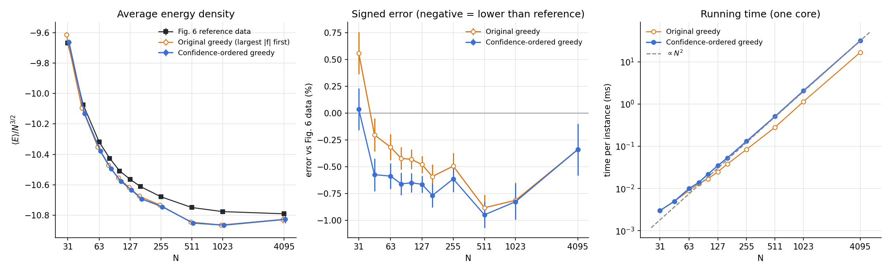

# Confidence-ordered greedy

An O(N²) greedy algorithm for dense QUBO ground states. Each spin is fixed exactly once, along its local field, and is never undone. The only flips after that are ones that strictly lower the energy. The order of fixing uses only the couplings and the spins already fixed, with no guesses about spins not yet fixed.



## Problem and terms

| Term | Meaning |
|---|---|
| x_i ∈ {0,1} | the QUBO variables, i = 1 … N |
| q_ij | symmetric coupling matrix with zero diagonal. In the test ensemble (Fig. 6), each entry is an integer uniform in [−100, 100], and it is nonzero with probability 0.1. |
| E | the cost to minimize: E = −Σ_{i,j} q_ij x_i x_j, summed over both orders of each pair |
| e = E/N^{3/2} | the energy density, the quantity plotted |
| s_i = 2x_i − 1 ∈ {−1,+1} | spin form. During the greedy, s_i = 0 means "not fixed yet". |
| h_i = Σ_j q_ij | the emergent field: the row sum of q. Substituting x = (1+s)/2 turns the QUBO into a spin glass in which each spin also feels this field. |
| f_i = h_i + Σ_{fixed j} q_ij s_j | local field on spin i from h and the spins fixed so far. Unfixed spins count as 0. Once every spin is fixed, flipping s_i changes the energy by s_i f_i, so the best sign for spin i is sign(f_i). |
| R_i = Σ_{unfixed j} q_ij² | the remaining coupling strength. While the other spins are still unfixed, the rest of f_i is a sum of their ±q_ij terms, whose size is about √R_i. |
| c = 0.01·mean(R) + 1 | a small regularizer, so that R_i + c > 0 |
| confidence_i = f_i² / (R_i + c)^{5/4} | how safely spin i can be fixed now: its field compared with how much that field can still change |

## The algorithm

1. **Start.** All spins are unfixed: s = 0, f = h. Compute R_i for every spin.
2. **Repeat N times:**
   1. **Pick** the unfixed spin b with the highest confidence. The original greedy picks the largest |f_b| instead. Dividing by the remaining coupling strength favors spins whose field is already settled over spins whose field is large but could still change sign.
   2. **Fix it** along its field: s_b = sign(f_b). This choice is final.
   3. **Update** every f_j by q_jb·s_b, and every R_j by −q_jb².
3. **Descent.** Repeatedly flip the spin with the most negative s_i·f_i, which is the flip that lowers E the most. Stop when no single flip lowers E. Each flip only goes downhill.

The exponent 5/4 and the regularizer c were tuned on random instances. The exponent works better than 1, which would be the plain signal-to-noise ratio |f|/√R squared.

**Cost.** Each step of 2 is one O(N) scan plus one O(N) row update. Step 3 makes only about 0.01N flips. The total is about 2N² operations, so O(N²). Measured times are 0.5 ms at N = 511, 2 ms at N = 1023 and 32 ms at N = 4095 on one Apple-silicon core.

**Results.** Both curves average fresh random instances of the Fig. 6 ensemble at each N: 20 000 instances at small N, down to 60 at N = 4095. Each average is compared with the Fig. 6 reference data at the same N. Error = (⟨e⟩ − e_ref)/|e_ref|.

| | N = 31 | 127 | 511 | 1023 | 4095 |
|---|---|---|---|---|---|
| Original greedy (largest \|f\| first, then descent) | +0.56% | −0.48% | −0.88% | −0.81% | −0.34% |
| This version | +0.04% | −0.66% | −0.95% | −0.83% | −0.34% |

Negative means lower than the reference values. The gain is largest at small N. At N ≥ 1023 this version matches the original greedy within the error bars.

## Run it

```
cc -O3 -o greedy_qubo greedy_qubo.c -lm
./greedy_qubo instance.txt         # first line N, then "i j q_ij" per nonzero pair (1-based, i<j)
./greedy_qubo -gen 1023 100 1      # 100 random Fig. 6 instances at N=1023, mean ± SE vs the reference
```
