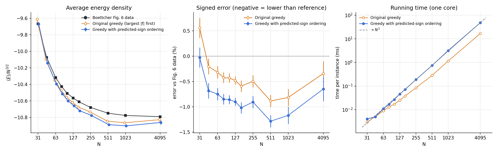

# Greedy with predicted-sign ordering

An O(N²) greedy algorithm for dense QUBO ground states. Each spin is fixed exactly once, along its local field, and is never undone. The only flips after that are ones that strictly lower the energy. The ordering also uses a running guess of the signs of spins not yet fixed. That is a mild form of look-ahead; [`../greedy`](../greedy) is the version without it.



## Problem and terms

| Term | Meaning |
|---|---|
| x_i ∈ {0,1} | the QUBO variables, i = 1 … N |
| q_ij | symmetric coupling matrix with zero diagonal. In the test ensemble (Boettcher, PRR 1, 033142, Fig. 6), each entry is an integer uniform in [−100, 100], and it is nonzero with probability 0.1. |
| E | the cost to minimize: E = −Σ_{i,j} q_ij x_i x_j, summed over both orders of each pair |
| e = E/N^{3/2} | the energy density, the quantity plotted |
| s_i = 2x_i − 1 ∈ {−1,+1} | spin form. During the greedy, s_i = 0 means "not fixed yet". |
| h_i = Σ_j q_ij | the emergent field: the row sum of q. Substituting x = (1+s)/2 turns the QUBO into a spin glass in which each spin also feels this field. |
| f_i = h_i + Σ_{fixed j} q_ij s_j | local field on spin i from h and the spins fixed so far. Unfixed spins count as 0. Once every spin is fixed, flipping s_i changes the energy by s_i f_i, so the best sign for spin i is sign(f_i). |
| R_i = Σ_{unfixed j} q_ij² | the remaining coupling strength: how much f_i can still change before every spin is fixed |
| c = 0.01·mean(R) + 1 | a small regularizer, so that R_i + c > 0 |
| p_j ∈ {−1,+1} | predicted sign of an unfixed spin j. It is a guess, used only for ordering. |
| P_i = Σ_{unfixed j} q_ij p_j | predicted field: the part of f_i still to come, if the guesses p are right |
| A = min(0.4, 0.05·log₂N − 0.12) | weight of the predicted field. It grows slowly with N. |

## The algorithm

1. **Start.** All spins are unfixed: s = 0, f = h. Compute R_i for every spin. Set p_j = sign(h_j) and compute P_i.
2. **Repeat N times:**
   1. **Anticipated field.** For every unfixed spin, compute u_i = f_i + A_t·P_i. The weight A_t = A·(0.6 + 2·n_unfixed/N) falls from 2.6A to 0.6A as spins get fixed, because early on most of each field is still to come.
   2. **Confidence.** Score each unfixed spin:
      - if u_i and f_i have the same sign, score_i = u_i² / (R_i + c)^{5/4};
      - if they disagree, score_i = 0.1·f_i² / (R_i + c)^{5/4}.

      A spin is safe to fix when its field is large compared with how much its field can still change. A spin whose actual and anticipated fields disagree is held back.
   3. **Fix** the spin b with the highest score: s_b = sign(f_b). This choice is final. Update every f_j by q_jb·s_b and every R_j by −q_jb².
   4. **Correct one guess.** Among the unfixed spins whose guess p_m opposes their anticipated field u_m, flip the guess with the largest |u_m|, then update P.
3. **Descent.** Repeatedly flip the spin with the most negative s_i·f_i, which is the flip that lowers E the most. Stop when no single flip lowers E. Each flip only goes downhill.

**Cost.** Each step of 2 is one O(N) scan plus at most two O(N) row updates. Step 3 makes only about 0.01N flips. The total is about 3N² operations, so O(N²). Measured times are 0.7 ms at N = 511, 3 ms at N = 1023 and 48 ms at N = 4095 on one Apple-silicon core.

**Results.** Both curves average fresh random instances of the Fig. 6 ensemble at each N: 20 000 instances at small N, down to 60 at N = 4095. Each average is compared with Boettcher's Fig. 6 data at the same N. Error = (⟨e⟩ − e_ref)/|e_ref|.

| | N = 31 | 127 | 511 | 1023 | 4095 |
|---|---|---|---|---|---|
| Original greedy (largest \|f\| first, then descent) | +0.56% | −0.48% | −0.88% | −0.81% | −0.34% |
| This version | −0.02% | −0.90% | −1.28% | −1.17% | −0.65% |

Negative means lower than the reference values.

## Run it

```
cc -O3 -o greedy_qubo greedy_qubo.c -lm
./greedy_qubo instance.txt         # first line N, then "i j q_ij" per nonzero pair (1-based, i<j)
./greedy_qubo -gen 1023 100 1      # 100 random Fig. 6 instances at N=1023, mean ± SE vs the reference
```
